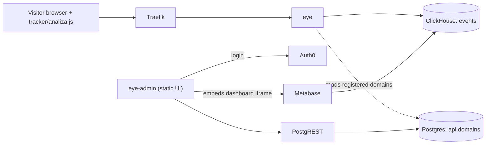

# analiza.dev

Privacy-focused, low-cost website analytics. GDPR compliant, no cookies. Site owners embed a small script on their pages and see the traffic in a dashboard.

## What the project does

### What is collected

`eye` accepts events at `POST /eye` and stores them in the ClickHouse `events` table (`eye/eye.go`). Per event it stores:

- tenant id (the `tenant` attribute of the script tag) and the domain, taken from the request `Origin` header
- event type: `view` (page visible / navigation) or `gone` (page hidden)
- page path (trailing slash trimmed) and the `utm_source`, `utm_medium`, `utm_campaign`, `utm_term`, `utm_content` query parameters of the page URL
- referrer
- browser name/version, OS and version, device, and bot/mobile/tablet/desktop flags parsed from the `User-Agent`
- country (ISO code) resolved from the client IP with a Geo-IP database
- insert time
- `user_id`: a keyed hash, not an identity. `eye` reads the client IP from `X-Real-Ip` (fallback `X-Forwarded-For`) and computes a highwayhash keyed with `ANALIZA_HASH_SEED` over the year-month period, user agent, `Accept-Language` and the IP. The raw IP is never stored; it is used only for this hash and the Geo-IP lookup. Visitor identifiers rotate every month and change entirely if the seed changes.

The tracker uses no cookies and no storage of any kind.

### How it works



Events are only stored when the request `Origin` host matches a domain registered for the tenant, or a subdomain of one: `eye` walks the request host from the full name up to the root and accepts it if any parent is registered (`eye/dns.go`). Requests without an `Origin` are ignored.

### Components

| Component | Folder / image | Purpose |
| --- | --- | --- |
| `tracker` | `tracker/analiza.js` | Browser script that POSTs page-view events; published minified to a CDN by `.github/workflows/tracker-publish.yml` |
| `eye` | built from `./eye` (Go) | Ingestion API on port 8080 (`/eye`, `/health`); enriches and batches events into ClickHouse, reads registered domains from Postgres |
| `eye-admin` | built from `eye-admin/` (Vite/React) | Admin UI: Auth0 login, domain management via PostgREST, Metabase dashboard embedded in an iframe |
| `landing` | `landing/` (Hugo) | Public landing page, built to static files |
| `postgrest` | `postgrest/postgrest:v14.13` | REST API over the Postgres `api` schema for the admin UI; config in `postgrest/*.conf`, migrations in `postgrest/schema/` |
| `postgres` | `postgres:18.6-alpine` | Relational database (`eye_admin` DB, `api` schema); first-boot init in `postgres/init/` |
| `clickhouse` | `clickhouse/clickhouse-server:26.8.36.3` | Event store (`eye.events`); first-boot init in `eye/clickhouse/init/` |
| `metabase` | `metabase/metabase:v0.65.2.4` | Dashboards over ClickHouse, statically embedded into the admin UI |
| `traefik` | `traefik:v2.11` | Reverse proxy on host port 8080, routes by `Host` header from container labels |
| `promtail` | `promtail/` (`grafana/promtail:3.6.11`) | Optional log shipping to a Loki push URL (`PROMTAIL_CLIENT_URL`); separate compose file |

Traefik and promtail reach the Docker API through a read-only socket proxy (`docker-socket-proxy` service); the raw socket is never mounted into them.

## Local development

Prerequisites:

- Docker with the Compose plugin (`docker compose`).
- For working on individual services: Go 1.26 (`eye/go.mod`), Node.js 22 + yarn (as pinned in `.github/workflows`), Hugo (`landing`).
- Nix + direnv provides this toolchain automatically: `.envrc` loads `nix/shell.nix`. Setup guide: https://nicu.dev/dirnev-nix-shell
- `.envrc` exports `DOCKER_SOCK=/run/user/1000/docker.sock` (rootless Docker, UID 1000). `.envrc.private` is sourced before that export, so it cannot override `DOCKER_SOCK`. On a rootful Docker setup, prefix commands with `DOCKER_SOCK=/var/run/docker.sock`.

### 1. Hosts

Add these entries to `/etc/hosts`:

```
127.0.0.1 api.dev.analiza.lan
127.0.0.1 admin.dev.analiza.lan
127.0.0.1 metabase.dev.analiza.lan
127.0.0.1 openapi.dev.analiza.lan
```

### 2. Start the stack

Use the same setup CI uses (named volumes, test PostgREST config):

```
export COMPOSE_ARGS="-f docker-compose.yml -f docker-compose.ci.yml"
export ANALIZA_POSTGREST_CONFIG=./postgrest/postgrest.test.conf
make start
```

`docker-compose.ci.yml` swaps the Postgres/ClickHouse host bind mounts for named volumes (`pgdata`, `chdata`), so no data directory is needed. Without it, data goes under `ANALIZA_DATA_DIR` (default `/data/analiza`), and you must create `$ANALIZA_DATA_DIR/postgres` before the first start — with rootless Docker the daemon cannot create a host path under `/data` itself. All other defaults (passwords etc.) work locally with no `.env`.

`make start_detached` also starts promtail, which expects `PROMTAIL_CLIENT_URL` (a Loki push URL). promtail is optional log shipping, so prefer plain `make start` unless you want it. `make stop` stops the stack, `make logs` prints the logs, and `make clean` runs `down -v`, which deletes the volumes and therefore the data.

### 3. Local URLs

Everything is served by Traefik on host port 8080:

| URL | What |
| --- | --- |
| `http://api.dev.analiza.lan:8080/eye` | Ingestion endpoint (POST) |
| `http://api.dev.analiza.lan:8080/health` | Health check |
| `http://admin.dev.analiza.lan:8080` | PostgREST API used by the admin UI |
| `http://metabase.dev.analiza.lan:8080` | Metabase |
| `http://openapi.dev.analiza.lan:8080` | Swagger UI — only under the compose `dev` profile, which the Makefile targets enable |

### 4. Admin UI

```
cd eye-admin
yarn
VITE_E2E_MOCK_AUTH=true yarn dev
```

Opens on http://localhost:5174. Mock auth (the `VITE_E2E_MOCK_AUTH` alias in `vite.config.ts` swaps `@auth0/auth0-react` for `src/mocks/auth0.tsx`) bypasses Auth0 and returns a locally signed token that `postgrest.test.conf` accepts. Domain management works; the Metabase dashboard iframe cannot load because the mock ID token carries a dummy `metabase/jwt` claim.

The committed `eye-admin/.env` points at the project's development Auth0 tenant. To use your own tenant, put `REACT_APP_*` overrides in the git-ignored `eye-admin/.env.private` and run `make start` in `eye-admin` (its Makefile exports that file), and use the default `postgrest.basic.conf` with your tenant's values — see [Self-hosting](#4-auth0) and [PostgREST config](#5-postgrest-config).

### 5. Send a test event

The root `index.html` is not a usable local test page: it loads the tracker from the hosted CDN URL with `tenant="local"` and no `hostname` attribute, and the tracker disables itself unless `tenant` is a 36-character UUID. Instead, with the stack from step 2 running and the mock-auth admin UI open at http://localhost:5174, add the domain `test.analiza.lan` (the mock user's tenant id is `123e4567-e89b-12d3-a456-426614174000`), then send the same event CI sends (`.github/workflows/e2e-playwright-test.yml`):

```
curl -X POST -H "Content-Type: application/json" -H "Host: api.dev.analiza.lan" -H "Origin: https://test.analiza.lan" -d '{"t":"view","p":"/","u":"123e4567-e89b-12d3-a456-426614174000","r":"https://example.com"}' http://localhost:8080/eye
```

`/eye` accepts POST (and OPTIONS for CORS preflight) with a JSON body `{"t","p","u","r"}` capped at 64 KiB. Check that the event landed:

```
docker compose $COMPOSE_ARGS exec -T clickhouse clickhouse-client -u eye_admin --password eye_super_duper_password -q "SELECT count() FROM eye.events WHERE tenant_id = '123e4567-e89b-12d3-a456-426614174000'"
```

### 6. Work on individual services

| Service | Commands (run in the service folder) |
| --- | --- |
| `eye` | `go test ./...`, `make build` |
| `eye-admin` | `yarn lint`, `yarn type-check`, `yarn build` |
| `tracker` | `npm ci`, `npm run lint` |
| `landing` | `make start` (Hugo dev server), `make build` (`hugo --gc --minify`) |

CI runs the lint/type-check/build steps per `.github/workflows` (`eye-admin-ci.yml`, `tracker-ci.yml`, `landing-ci.yml`, `eye-ci.yml`).

### 7. End-to-end tests

Playwright tests against mock auth; the stack must be running with the test PostgREST config as in step 2. Follow `.github/workflows/e2e-playwright-test.yml`: Node 22, then in `eye-admin`:

```
yarn
npx playwright install --with-deps
yarn test:e2e
```

The dev server does not need to be started manually: `eye-admin/playwright.config.ts` starts it itself (`webServer.command: npm run dev` on http://localhost:5174, `reuseExistingServer: true`). `yarn test:e2e` runs Playwright with `VITE_E2E_MOCK_AUTH=true`.

## Self-hosting

You need: a Docker host; DNS names for the ingestion API, PostgREST and Metabase; a TLS-terminating reverse proxy or load balancer in front (the Traefik in this repo serves plain HTTP on host port 8080 only); an Auth0 tenant (the admin UI requires Auth0, there is no built-in login); and static hosting for the admin UI and the tracker script. promtail is not needed and the steps below do not start it. The compose file caps ClickHouse at 4 CPUs / 8 GB and Metabase at 2 CPUs / 2 GB — those are limits, not requirements. The hostnames below use `example.com`.

### 1. Clone

Clone this repository onto the Docker host. Deploying builds `eye` from the checkout (`eye/Dockerfile`), so the checkout must stay on the host.

### 2. Hostnames

The Traefik router rules in `docker-compose.yml` are hardcoded to the `analiza.dev` / `dev.analiza.lan` hosts. Create a `docker-compose.override.yml` next to `docker-compose.yml` — Compose auto-loads it when no `-f` is passed, and merges labels by key:

```yaml
services:
  eye:
    labels:
      - "traefik.http.routers.api.rule=Host(`api.example.com`)"
  postgrest:
    labels:
      - "traefik.http.routers.admin.rule=Host(`admin.example.com`)"
  metabase:
    labels:
      - "traefik.http.routers.metabase-public.rule=(Host(`metabase.example.com`)) && (PathPrefix(`/embed`) || PathPrefix(`/public`) || PathPrefix(`/app`) || PathPrefix(`/api/embed`) || PathPrefix(`/api/public`) || Path(`/api/session/properties`) || Path(`/api/geojson`) || Path(`/api/health`))"
      - "traefik.http.routers.metabase.rule=Host(`metabase.example.com`)"
```

The `metabase-public` rule keeps the full `PathPrefix`/`Path` list from `docker-compose.yml` (the embed endpoints must stay reachable without the admin IP allowlist; the router keeps its `priority=100`). Validate the merged config and check the labels were overridden:

```
docker compose -f docker-compose.yml -f docker-compose.override.yml config -q
docker compose -f docker-compose.yml -f docker-compose.override.yml config | grep 'rule='
```

### 3. Secrets

Neither `.env` nor `docker-compose.override.yml` is git-ignored at the repo root — do not commit them. Create `.env` next to `docker-compose.yml` with the block below, run in a POSIX shell such as bash. Compose reads `.env` itself — the shell never sees these variables, and Compose does not run `$(...)` inside `.env`, so generate the values in the shell first. Hex output keeps the passwords URL-safe in `db-uri`:

```
for name in ANALIZA_POSTGRES_PASSWORD ANALIZA_EYE_PG_PASSWORD ANALIZA_CH_ADMIN_PASSWORD ANALIZA_EYE_CH_PASSWORD ANALIZA_METABASE_DB_PASSWORD ANALIZA_HASH_SEED; do
  echo "$name=$(openssl rand -hex 32)"
done > .env

cat >> .env <<'EOF'
ANALIZA_DATA_DIR=/data/analiza
ANALIZA_POSTGREST_CONFIG=./postgrest/postgrest.conf.private
ANALIZA_HTTP_BIND=127.0.0.1
ANALIZA_ADMIN_CORS_ORIGINS=https://app.example.com
ANALIZA_METABASE_ADMIN_ALLOWLIST=<your IP>/32
EOF
```

Keep `ANALIZA_HTTP_BIND=0.0.0.0` when the TLS proxy runs on another machine.

| Variable | Default | Used for |
| --- | --- | --- |
| `ANALIZA_POSTGRES_PASSWORD` | public default | Postgres superuser password; also the `postgrest` role password (`postgres/init/init_1_postgrest.sh`) and the Flyway `-password` args |
| `ANALIZA_EYE_PG_PASSWORD` | public default | Password the `eye` service connects to Postgres with |
| `ANALIZA_CH_ADMIN_PASSWORD` | public default | ClickHouse admin (`eye_admin`) password |
| `ANALIZA_EYE_CH_PASSWORD` | public default | ClickHouse `eye` user password (`eye/clickhouse/init/init.sh`) |
| `ANALIZA_METABASE_DB_PASSWORD` | public default | Metabase DB user password (`postgres/init/init_metabase.sh`) |
| `ANALIZA_HASH_SEED` | committed 64-hex literal (`eye/config.go`) | Key for the visitor hash; must be exactly 64 hex characters. Changing it later gives returning visitors new identifiers |
| `ANALIZA_DATA_DIR` | `/data/analiza` | Host directory holding the `postgres` and `clickhouse-server` data |
| `ANALIZA_POSTGREST_CONFIG` | `./postgrest/postgrest.basic.conf` | PostgREST config file mounted into the `postgrest` container |
| `ANALIZA_HTTP_BIND` | `0.0.0.0` | Host address Traefik binds port 8080 to; use `127.0.0.1` when the TLS proxy runs on the same host |
| `ANALIZA_ADMIN_CORS_ORIGINS` | public default list | CORS allow-origin list on the PostgREST router; set it to your admin UI origin |
| `ANALIZA_METABASE_ADMIN_ALLOWLIST` | `0.0.0.0/0,::/0` (allows everyone) | Source ranges allowed on the admin Metabase router; restrict it to your own IPs |
| `DOCKER_SOCK` | `/var/run/docker.sock` | Docker socket mounted into the socket proxies |

The password and hash-seed defaults are publicly known values, so those must be set. The role passwords (Postgres roles, Metabase DB, ClickHouse `eye`) are applied only when the data directory is first initialised — the init scripts run only on an empty data dir (`postgres/init/`, `eye/clickhouse/init/init.sh`). Changing them later requires `ALTER USER` by hand.

Create the data directory before the first start (`.env` is read by Compose, not by your shell, so use the literal path and match it to `ANALIZA_DATA_DIR` if you changed it):

```
mkdir -p /data/analiza/postgres
```

### 4. Auth0

In your Auth0 tenant create:

- a Single Page Application for the admin UI, with the UI origin in its allowed callback, logout and web-origin URLs. The callback path is fixed by the code: `redirect_uri` is `<UI origin>/auth-callback` (`eye-admin/src/App.tsx`).
- an API whose identifier is the audience (sent as `VITE_AUTH0_AUDIENCE` and checked as `jwt-aud`).
- a Post-Login Action that sets these custom claims:
  - access token `https://analiza.dev/role`: `analiza` — the Postgres role PostgREST switches to
  - access token `https://analiza.dev/user`: a stable UUID for the user, used as the tenant id (row-level security in `postgrest/schema/V1__init.sql` matches it against `tenant_id`)
  - ID token `metabase/jwt`: a Metabase static-embedding JWT, signed HS256 with the Metabase embedding secret, payload `{ "resource": { "dashboard": <id> }, "params": { "tenant": <tenant UUID> }, "exp": <unix time> }` (consumed by `eye-admin/src/pages/Dashboard.tsx`, which iframes `/embed/dashboard/<jwt>`)

The claim names are fixed by the code (`postgrest/schema/V1__init.sql`, `postgrest/postgrest.basic.conf`, `eye-admin/src/pages/Dashboard.tsx`). Example Action to adapt — it needs `jsonwebtoken` added as a dependency of the Action:

```js
const jwt = require('jsonwebtoken');
const { randomUUID } = require('crypto');

exports.onExecutePostLogin = async (event, api) => {
  let tenantId = event.user.app_metadata.tenant_id;
  if (!tenantId) {
    tenantId = randomUUID();
    api.user.setAppMetadata('tenant_id', tenantId);
  }

  api.accessToken.setCustomClaim('https://analiza.dev/role', 'analiza');
  api.accessToken.setCustomClaim('https://analiza.dev/user', tenantId);

  const metabaseJwt = jwt.sign(
    {
      resource: { dashboard: Number(event.secrets.METABASE_DASHBOARD_ID) },
      params: { tenant: tenantId },
      exp: Math.floor(Date.now() / 1000) + 600,
    },
    event.secrets.METABASE_EMBEDDING_SECRET,
  );
  api.idToken.setCustomClaim('metabase/jwt', metabaseJwt);
};
```

### 5. PostgREST config

Copy `postgrest/postgrest.basic.conf` to a `*.private` filename such as `postgrest/postgrest.conf.private` (`*.private` is git-ignored), point `ANALIZA_POSTGREST_CONFIG` at it, and change:

- the password in `db-uri` to the value of `ANALIZA_POSTGRES_PASSWORD` (the `postgrest` role takes its password from there)
- `jwt-aud` to your API identifier
- `jwt-secret` to your tenant's `https://<tenant>/.well-known/jwks.json` content (the committed value is the development tenant's key)

Leave `jwt-role-claim-key` alone.

### 6. Start

Run `docker compose up -d --build` directly, not `make start*` — the Makefile enables the `dev` profile, which adds the Swagger UI. Flyway migrations run automatically on start (`postgrest_flyway`, `eye_flyway`), and `eye` creates its ClickHouse tables at startup (`initTables` in `eye/eye.go`).

### 7. Set the eye database password

Trap: migration `eye/postgres/schema/V1__init.sql` creates the `eye` role with a hardcoded password, and `ANALIZA_EYE_PG_PASSWORD` only sets the password `eye` connects with. With a non-default `ANALIZA_EYE_PG_PASSWORD`, `eye` cannot connect until you run, after the first start:

```
docker compose exec postgres psql -U postgres -d eye_admin -c "ALTER USER eye WITH PASSWORD '<ANALIZA_EYE_PG_PASSWORD>'"
docker compose up -d eye
```

(With the shipped default both sides are the same value, so this is then a no-op.)

### 8. TLS and client IPs

Terminate TLS in your proxy in front and forward to host port 8080. The `web` entrypoint only trusts forwarded headers and PROXY protocol from `10.0.0.0/16` (`docker-compose.yml`, Traefik `command`: `--entrypoints.web.forwardedHeaders.trustedIPs=10.0.0.0/16` and `--entrypoints.web.proxyProtocol.trustedIPs=10.0.0.0/16`). If your proxy connects from another range, edit both `trustedIPs` flags. This matters because `eye` reads `X-Real-Ip` (fallback `X-Forwarded-For`) for the visitor hash and the Geo-IP lookup (`eye/eye.go`) — a wrong setting makes all visitors look like the proxy. The Geo-IP database is downloaded when the `eye` image is built (`eye/Dockerfile`), so the build needs network access; rebuilding refreshes it.

### 9. Metabase

Open Metabase on your host (`https://metabase.example.com`) from an allowlisted IP (`ANALIZA_METABASE_ADMIN_ALLOWLIST`), create the admin account, and add the ClickHouse database: host `clickhouse`, port `8123`, database `eye`, plus a user — create a dedicated read-only ClickHouse user rather than reusing `eye`, which has full rights on the database (`eye/clickhouse/init/init.sh`). Build a dashboard on `eye.events` with a filter on `tenant_id` exposed as a dashboard parameter named `tenant`; enable static embedding with `tenant` as a locked parameter. Copy the embedding secret and the dashboard id into the Auth0 Action. No dashboard ships with this repo.

### 10. Admin UI

Build `eye-admin` with your values (output goes to `eye-admin/dist`, the Vite default — `vite.config.ts` sets no `outDir`):

```
cd eye-admin
VITE_POSTGREST_URL=https://admin.example.com \
VITE_METABASE_URL=https://metabase.example.com \
VITE_AUTH0_DOMAIN=<your tenant>.auth0.com \
VITE_AUTH0_CLIENT_ID=<SPA client id> \
VITE_AUTH0_AUDIENCE=<API identifier> \
VITE_TRACKER_URL=https://cdn.example.com/analiza.js \
yarn && yarn build
```

The code reads `VITE_*` first and falls back to `REACT_APP_*` (`App.tsx`, `ApiProvider.tsx`, `Dashboard.tsx`, `hooks/domains.ts`), and Vite does not override variables already present in the environment with `.env` file values — so exported `VITE_*` variables take priority over the committed `eye-admin/.env` development values. Before building, edit `eye-admin/public/_headers`: its Content-Security-Policy hard-codes `https://admin.analiza.dev` in `connect-src` and `https://metabase.analiza.dev` in `frame-src` — replace them with your PostgREST and Metabase origins. `_headers` and `_redirects` use the Netlify format; on other hosts, reproduce the headers and the SPA fallback (`/*  /index.html  200`) yourself. `ANALIZA_ADMIN_CORS_ORIGINS` (set in step 3) must contain the UI origin; changing it later needs `docker compose up -d` to recreate Traefik with the new label. Then host `dist/` statically.

### 11. Tracker

Host `tracker/analiza.js` yourself (or minified, as `tracker-publish.yml` does with terser). The default endpoint is `https://api.analiza.dev`; the `hostname` attribute overrides it and is used as `endpoint + "/eye"`, so the scheme is required:

```html
<script defer src="https://cdn.example.com/analiza.js" tenant="<UUID>" hostname="https://api.example.com"></script>
```

Trap: the snippet shown in the admin UI (`installSnippet` in `eye-admin/src/hooks/domains.ts`) has no `hostname` attribute, so it posts to the default endpoint — add `hostname` by hand on each site, or change the default in your copy of the tracker. `tenant` must be a 36-character UUID or the tracker disables itself. Register each site's domain in the admin UI; events are accepted when the page's `Origin` matches a registered domain or a subdomain of it.

### 12. Verify

```
curl https://api.example.com/health
```

Then sign in to the admin UI, add a domain, load a page that carries the snippet, and confirm events arrive in `eye.events` (or in the dashboard).

### 13. Operations

- Upgrades: `git pull && docker compose up -d --build`. Migrations run on every start.
- Backups: everything lives under `ANALIZA_DATA_DIR` (`postgres/`, `clickhouse-server/`). A major Postgres upgrade cannot reuse the data directory in place (the `PGDATA` layout is version-specific): dump with `pg_dumpall` into a fresh data directory.
- Known limitation: the admin UI's export page only inserts rows into `api.export_requests`; nothing in this repo polls or fulfils them.

### 14. Optional: log shipping with promtail

Skip this unless you run Loki. To enable it, set `PROMTAIL_CLIENT_URL` to your Loki push URL and run `PROMTAIL_CLIENT_URL=<loki push url> make -C promtail start_detached` (`promtail/` has its own compose file, which plain `docker compose up` does not start).
